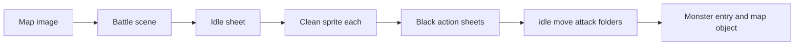

# 2D entity generation pipeline

The pipeline has the same shape as the interior walkthrough in [tools/painted_map_pipeline/interiors/cli.py](tools/painted_map_pipeline/interiors/cli.py): a session folder under `generated/`, each step runnable on its own, and a pause to look at the result before the next paid image. Every drawing step uses `generate_with_image_reference` in [tools/painted_map_pipeline/leonardo_api.py](tools/painted_map_pipeline/leonardo_api.py). Cutting, matting, and packing stay in [tools/sprite_assets](tools/sprite_assets).

These are ground fighters. Frames go in `Graphics/Monsters/<name>/{idle,move,attack}/` and the monster gets a `monster_data` entry, so it loads the way existing monsters do. Frames face right. Enemies default to `animations_left_right_indicator=True`, so `import_graphics_left_right` in [Code/Enemy.py](Code/Enemy.py) already flips them for left. The flyer class is not the target.

## Where it lives

- New package [tools/entity_pipeline/cli.py](tools/entity_pipeline/cli.py), run as `python -m tools.entity_pipeline.cli`.
- Session files go in `generated/entity_pipeline/<session>/`. Add `generated/entity_pipeline/` to `.gitignore`, because only `generated/building_interiors/` is covered today.
- The Necron sheet already cut into [generated/entity_sheets/necron_faction/cells](generated/entity_sheets/necron_faction/cells), with its hand-made [layout.json](generated/entity_sheets/necron_faction/layout.json), is the test fixture for `cut`. It is not regenerated.
- Each Leonardo call saves the `cost_usd` it returns into the session's `session.json`, so the cost of a warrior is on record.

## Commands

- `scene`: takes the map image and makes a battle picture with `generate_with_image_reference`. Nothing else is new.
- `sheet`: takes that picture and makes one idle sheet showing every distinct warrior. It uses the same Leonardo call. The prompt asks for:
  - one warrior per cell, facing right, at similar scale
  - a clear gap between cells
  - no text labels
- `cut`: takes the sheet and writes one clean RGBA png per warrior. See the section below.
- `anim`: takes one accepted sprite and makes still sheets on solid black for idle, move, and attack, one call per action. It uses the same Leonardo call with the clean sprite as the reference, so no parchment or caption gets copied. It runs on one warrior at a time, and only after you accept the cut. There is no video API in v1.
- `frames`: takes the three black sheets and fills the `00.png`… folders.
  1. Split each sheet into frames with the existing `detect_gutter_grid`, which is the black-gap detector `cut` already uses.
  2. Matte each frame with `matte_black_bg`.
  3. Fit across all three actions. Measure the figure's height in the idle frames, scale move and attack to match, and place every frame on one shared canvas with the feet on the same bottom-centre point. Do not run `trim_transparent` on each frame separately: frames of different sizes make the sprite jitter and change scale between actions.
  4. Pack with `pack_sequence` into `Graphics/Monsters/<name>/{idle,move,attack}/`.
  5. Write a contact sheet of all three rows for checking.

  If you already have a black-background video, it still goes through [tools/sprite_assets/extract_black_loop.py](tools/sprite_assets/extract_black_loop.py) and then into steps 3 to 5.
- `wire --map <path/to/map.tmx> --template tribey_spear`:
  - **Settings:** prints a `monster_data` entry for the new name, copied from the template monster's entry. It does not rewrite [Code/Settings.py](Code/Settings.py); you paste the entry in and tune the stats.
  - **Map:** adds one object to that map's `placed_entities` layer, with `entity_spawn_config` set to `{"kind": "enemy", "type": "<name>"}`. It refuses to run if the map has no `placed_entities` layer.
  - Does not touch `Code/flyer.py`.

`run` walks through `scene`, then `sheet`, then `cut`, and stops. `anim`, `frames`, and `wire` stay separate, so a bad sheet never leads to a dozen attack generations.

## The cut

`cut` in [tools/sprite_assets/cli.py](tools/sprite_assets/cli.py) finds black gutters (`detect_gutter_grid`). The Necron sheet is on parchment, so that pass found 6 cells and sliced through the figures. The 15 usable files came from `cut --layout` with boxes typed by hand. Those files still contain the parchment background and the caption (`BEASTMAN WARRIOR` under the figure).

`cut` in this pipeline does the following:

1. On a light sheet, it finds each figure as a connected dark region against the parchment colour. It writes `layout.json` in the existing `named_boxes` form, then calls the existing `cut --layout`. Black-gap sheets keep using `detect_gutter_grid`.
2. Finds the caption under each figure as a short, wide strip of small pieces separated from the body by a row of background. It reads the caption once to name the file, if it can be read, and then crops it out. Unreadable captions fall back to `warrior_00`, `warrior_01`, and so on.
3. Removes the light background with a parchment matte that works like `matte_black_bg` but keys on the sampled sheet colour. Then it runs `trim_transparent`, which is fine here because it is one frame per warrior.
4. Writes `cells/<name>.png` as clean RGBA, plus `contact.png`.

The check: on the Necron sheet the boxes it finds should match the hand-made `layout.json` to within a few pixels, and none of the 15 outputs should contain parchment or caption text.

## First warrior

Use `beastman_warrior`. Eleven of the 15 Necron figures are archangels, dragons, drakes, and sky units, which are fliers and out of scope. `warhound` is the second choice. A warrior is accepted when it walks, attacks, and turns in game without jittering or changing size between actions.

## Out of the first version

- Image-to-video, and cutting a warrior out of a moving desert shot. That was the slow path on the flyer. Actions are still sheets on black.
- A hurt animation. The normal monster player only has idle, move, and attack.
- Flying, including the winged Necron units. Altitude on `Entity` is a separate branch of work.
- Generating all 15 Necron attacks at once. One accepted warrior is the proof; then the same commands run on the others.
- Editing `Code/Settings.py` automatically.

## Later

### Align the paid-step review across the generation pipelines

`scene`, `sheet`, and `anim` send hardcoded prompts and print only the output path and the cost. The words that went, and the image that went with them, never appear on screen.

The interior walkthrough already does this, in [tools/painted_map_pipeline/interiors/cli.py](tools/painted_map_pipeline/interiors/cli.py):

- `_prompt_sent` reads the prompt file that actually went out.
- `_sent` prints it under `---- prompt sent ----`, then the images under `---- images sent ----`.
- `_show` opens the result.

That screen format is the one every paid pipeline should use. Do not import those three from `interiors.cli`: loading that module starts the whole interior walkthrough. Move them into a small module next to the Leonardo client, and point the interior commands and the entity commands at that one copy. `scene`, `sheet`, and `anim` write the prompt into the session (`scene_prompt.txt`, and the same for the other steps) and then call the shared printer with the source image.

Leave the interior accept and redraw menus where they are. Those are the walkthrough, not the prompt display. [tools/painted_map_pipeline/prompt_builder.py](tools/painted_map_pipeline/prompt_builder.py) is the map-chunk wording, not this screen format.
