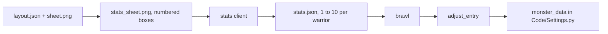

# Score the sheet, then map the numbers

Every cut warrior is still a copy of `tribey_spear` (`speed` 15, melee damage 6, health 70), so they all sprint and the attack clip never stays on screen. This step only sets combat numbers. Sprite size, frames, and the battle-scene scale are not touched.



## Rules for the implementer

- Other sessions edit this checkout live. `cli.py` and `wire.py` already have uncommitted changes. Re-read each file right before you edit it and keep those changes.
- `stats.py` must not import `leonardo_api` or `openai_api`. It may import `tools.painted_map_pipeline.api_common.api_key`.
- Do not change `cmd_fight`, `cmd_wire`, `install_monster_entries`, `frames.py`, `figures.py`, or any file under `Code/` except what brawl writes into `Code/Settings.py` at run time.
- Do not run the `stats` command (it is a paid call) or `brawl`. Run only the test command at the end.
- `warrior_00` means "cell 0", not a particular figure: the cutter numbers cells by position. So `stats.json` records the sheet file it scored, that file's SHA-256, and every cell box. `load_scores` ignores the file when any of these no longer match, so old scores are never applied to a redrawn or re-cut sheet.

## Step 1: config file

New file `tools/entity_pipeline/stats.openai.json`, exactly:

```json
{
  "api_key_env": "OPENAI_API_KEY",
  "model": "gpt-5-mini",
  "url": "https://api.openai.com/v1/chat/completions",
  "timeout_seconds": 120
}
```

Any vision model behind an OpenAI-style chat-completions URL works. To switch model, change `model` here or pass `--model`.

## Step 2: `tools/entity_pipeline/stats.py`

New module. Imports: `base64`, `hashlib`, `json`, `urllib.request`, `urllib.error`, `pathlib.Path`, `PIL.Image`, `PIL.ImageDraw`, `PIL.ImageFont`, `tools.sprite_assets.cut_sheet.cells_from_grid`, `tools.painted_map_pipeline.api_common.api_key`.

Module constants:

```python
DEFAULT_STATS_CONFIG = Path("tools/entity_pipeline/stats.openai.json")
DEFAULT_URL = "https://api.openai.com/v1/chat/completions"


class StatsClientError(RuntimeError):
    pass
```

### 2a. `sheet_cells(work: Path) -> list[tuple[str, tuple[int, int, int, int]]]`

The warriors in cut order, with their boxes on the sheet. This is the same order and the same names `cut_sheet` in `figures.py` used.

```python
def sheet_cells(work):
    path = work / "layout.json"
    if not path.exists():
        raise SystemExit(f"no {path}; run cut first")
    layout = json.loads(path.read_text(encoding="utf-8"))
    if "named_boxes" in layout:          # light (parchment) sheet
        return [(name, tuple(box)) for name, box in layout["named_boxes"]]
    cells = cells_from_grid(layout["row_spans"], layout["col_spans"])   # black-gap sheet
    return [(f"warrior_{i:02d}", cell.box) for i, cell in enumerate(cells)]
```

### 2b. `numbered_sheet(sheet: Path, cells, dest: Path) -> Path`

Draws each box and its index (0, 1, 2, ...) on a copy of the sheet so the model cannot mix up the order. Writes `dest` and returns it. `sheet.png` itself is never changed.

```python
def numbered_sheet(sheet, cells, dest):
    with Image.open(sheet) as source:
        image = source.convert("RGB")
    for name, box in cells:
        if box[2] > image.width or box[3] > image.height:
            raise SystemExit(f"layout.json does not fit {sheet}; pass the sheet you cut with --sheet")
    draw = ImageDraw.Draw(image)
    font = ImageFont.load_default(size=36)      # Pillow >= 11 is pinned, so size= works
    for index, (name, box) in enumerate(cells):
        draw.rectangle(box, outline=(255, 0, 0), width=3)
        label = str(index)
        spot = (box[0] + 6, box[1] + 4)
        draw.rectangle(draw.textbbox(spot, label, font=font), fill=(255, 255, 255))
        draw.text(spot, label, fill=(255, 0, 0), font=font)
    image.save(dest)
    return dest
```

### 2c. `build_prompt(count: int) -> str`

Use this text exactly. It holds literal `{` `}` from the JSON example, so **do not** call `.format()` or make it an f-string. Fill the two placeholders with `.replace()`.

```python
STATS_PROMPT = (
    "This sprite sheet shows <COUNT> game warriors. Each one has a red box with a number from 0 to <LAST>. "
    "Score every numbered warrior from how it looks. "
    "speed: 1 is slow and heavy (a siege machine, heavy armour), 10 is very fast (a light runner, a beast, a rider). "
    "damage: 1 is weak (unarmed, a tool), 10 hits very hard (a big weapon, a large monster). "
    "bulk: 1 is frail (thin, no armour), 10 is very tough (heavy armour, a big shield, a large creature or machine). "
    "reach: \"ranged\" if it carries a bow, sling, throwing weapon or catapult, or casts magic with a staff; otherwise \"melee\". "
    "label: a short name for what you see. "
    "Reply with JSON only, in this shape: "
    "{\"warriors\": [{\"cell\": 0, \"label\": \"archer\", \"speed\": 5, \"damage\": 5, \"bulk\": 5, \"reach\": \"melee\"}]} "
    "The list has exactly <COUNT> objects, one per number, cell 0 to <LAST>. "
    "speed, damage and bulk are whole numbers from 1 to 10."
)


def build_prompt(count):
    return STATS_PROMPT.replace("<COUNT>", str(count)).replace("<LAST>", str(count - 1))
```

### 2d. `ask_scores(image: Path, prompt: str, config: dict, model: str) -> str`

One POST with the standard library. Returns the reply text. The top level of the reply must be an object (`{"warriors": [...]}`), not a bare array, because `response_format` `json_object` only allows an object. Do **not** send `temperature` or `max_tokens`: some models reject them.

```python
def ask_scores(image, prompt, config, model):
    key = api_key(config, default_env="OPENAI_API_KEY", error_cls=StatsClientError)
    url = config.get("url") or DEFAULT_URL
    encoded = base64.b64encode(Path(image).read_bytes()).decode("ascii")
    body = {
        "model": model,
        "messages": [{
            "role": "user",
            "content": [
                {"type": "text", "text": prompt},
                {"type": "image_url", "image_url": {"url": f"data:image/png;base64,{encoded}"}},
            ],
        }],
        "response_format": {"type": "json_object"},
    }
    request = urllib.request.Request(
        url,
        data=json.dumps(body).encode("utf-8"),
        headers={"Authorization": f"Bearer {key}", "Content-Type": "application/json"},
        method="POST",
    )
    try:
        with urllib.request.urlopen(request, timeout=float(config.get("timeout_seconds", 120))) as response:
            data = json.loads(response.read().decode("utf-8"))
    except urllib.error.HTTPError as exc:
        detail = exc.read().decode("utf-8", "replace")[:2000]
        raise StatsClientError(f"HTTP {exc.code} from {url}: {detail}") from None
    except urllib.error.URLError as exc:
        raise StatsClientError(f"could not reach {url}: {exc.reason}") from None
    try:
        content = data["choices"][0]["message"]["content"]
    except (KeyError, IndexError, TypeError):
        raise StatsClientError(f"unexpected reply: {json.dumps(data)[:2000]}") from None
    if not isinstance(content, str):
        raise StatsClientError(f"reply has no text: {json.dumps(data)[:2000]}")
    return content
```

### 2e. `parse_scores(text: str, names: list[str]) -> dict[str, dict]`

Checks everything. Any problem raises `StatsClientError`, and the caller writes nothing.

```python
def parse_scores(text, names):
    body = text.strip()
    if body.startswith("```"):                     # some endpoints wrap JSON in a fence
        body = body.split("\n", 1)[1] if "\n" in body else ""
        body = body.rsplit("```", 1)[0]
    try:
        data = json.loads(body)
    except json.JSONDecodeError as exc:
        raise StatsClientError(f"reply is not JSON: {exc}") from None
    rows = data.get("warriors") if isinstance(data, dict) else None
    if not isinstance(rows, list):
        raise StatsClientError('reply has no "warriors" list')
    if len(rows) != len(names):
        raise StatsClientError(f"reply scored {len(rows)} warriors, the sheet has {len(names)}")
    scores = {}
    for row in rows:
        if not isinstance(row, dict):
            raise StatsClientError(f"not an object: {row!r}")
        cell = row.get("cell")
        if type(cell) is not int or not 0 <= cell < len(names):
            raise StatsClientError(f"bad cell number: {row!r}")
        name = names[cell]
        if name in scores:
            raise StatsClientError(f"cell {cell} was scored twice")
        for field in ("speed", "damage", "bulk"):
            value = row.get(field)
            if type(value) is not int or not 1 <= value <= 10:   # rejects True, 7.5, "7"
                raise StatsClientError(f"cell {cell}: {field} must be a whole number 1-10, got {value!r}")
        if row.get("reach") not in ("melee", "ranged"):
            raise StatsClientError(f'cell {cell}: reach must be "melee" or "ranged", got {row.get("reach")!r}')
        scores[name] = {
            "label": str(row.get("label") or ""),
            "speed": row["speed"],
            "damage": row["damage"],
            "bulk": row["bulk"],
            "reach": row["reach"],
        }
    return scores
```

Right length plus unique in-range cell numbers means every warrior is scored exactly once.

### 2f. `save_scores` and `load_scores`

`save_scores` writes `stats.json` with what was scored. `load_scores` is what brawl and `stats` read: it returns the scores only when the same sheet file (same bytes) and the same cell boxes are still in place, and an empty dict otherwise.

```python
def _sha256(path):
    return hashlib.sha256(Path(path).read_bytes()).hexdigest()


def _cell_list(cells):
    return [[name, list(box)] for name, box in cells]


def save_scores(work, model, sheet, cells, scores):
    record = {
        "model": model,
        "sheet": str(sheet),
        "sheet_sha256": _sha256(sheet),
        "cells": _cell_list(cells),
        "scores": scores,
    }
    path = work / "stats.json"
    path.write_text(json.dumps(record, indent=2) + "\n", encoding="utf-8")
    return path


def load_scores(work):
    path = work / "stats.json"
    if not path.exists():
        return {}
    data = json.loads(path.read_text(encoding="utf-8"))
    sheet = Path(data.get("sheet", ""))
    same_sheet = sheet.is_file() and _sha256(sheet) == data.get("sheet_sha256")
    same_cells = data.get("cells") == _cell_list(sheet_cells(work))
    if not (same_sheet and same_cells):
        print(f"stats: {path} is for a different sheet or cut; run stats --force")
        return {}
    return data["scores"]
```

The boxes in `cells` come from `layout.json`, so a fresh `cut` that moves or adds a cell fails the check. The hash catches a redrawn sheet even when the grid lands on the same boxes.

### 2g. `print_scores(scores: dict[str, dict]) -> None`

One line per warrior:

```python
def print_scores(scores):
    for name, s in scores.items():
        print(f"  {name}  {s['label'][:28]:<28}  speed {s['speed']:>2}  damage {s['damage']:>2}  "
              f"bulk {s['bulk']:>2}  {s['reach']}")
```

## Step 3: the map, in `tools/entity_pipeline/wire.py`

Add `import copy` at the top. Add these constants under the existing ones:

```python
MELEE_RADIUS = 50          # tribey_spear's melee_attack_radius
MELEE_COOLDOWN = 1000      # tribey_spear's melee cooldown
RANGED_RADIUS = 200
RANGED_COOLDOWN = 1500     # demon_dog's
PROJECTILE = "demon_dog_projectile"
```

### 3a. `_band(score, lo, hi) -> int`

```python
def _band(score: int, lo: int, hi: int) -> int:
    """1 -> lo, 10 -> hi, straight line between, rounded."""
    return round(lo + (score - 1) * (hi - lo) / 9)
```

Results (no score lands on a .5, so rounding is unambiguous):

| score | 1 | 2 | 3 | 4 | 5 | 6 | 7 | 8 | 9 | 10 |
|---|---|---|---|---|---|---|---|---|---|---|
| speed `_band(s, 2, 6)` | 2 | 2 | 3 | 3 | 4 | 4 | 5 | 5 | 6 | 6 |
| damage `_band(d, 3, 12)` | 3 | 4 | 5 | 6 | 7 | 8 | 9 | 10 | 11 | 12 |
| health `_band(b, 40, 140)` | 40 | 51 | 62 | 73 | 84 | 96 | 107 | 118 | 129 | 140 |

The model never gives a pixel speed. 15 is gone; 6 is a run, 2 is a walk.

### 3b. `adjust_entry(entry: dict, score: dict) -> dict`

Returns a new dict. Never changes `entry`. Running it twice gives the same result, and it switches cleanly between melee and ranged if a re-score changes `reach`.

```python
def adjust_entry(entry: dict, score: dict) -> dict:
    out = copy.deepcopy(entry)
    config = out.setdefault("combat_config", {})
    context = config.setdefault("combat_context", {})
    out["speed"] = _band(score["speed"], 2, 6)
    out["health"] = _band(score["bulk"], 40, 140)
    damage = _band(score["damage"], 3, 12)
    if score["reach"] == "ranged":
        out["attack_type"] = "ranged"
        config["melee_attacks"] = []
        config["ranged_attacks"] = [{"type": PROJECTILE, "damage": damage, "cooldown": RANGED_COOLDOWN}]
        config["melee_attack_radius"] = 0
        config["ranged_attack_radius"] = RANGED_RADIUS
        context["fire_projectile"] = True
    else:
        out["attack_type"] = "melee"
        config["melee_attacks"] = [{"damage": damage, "cooldown": MELEE_COOLDOWN}]
        config["ranged_attacks"] = []
        config["melee_attack_radius"] = MELEE_RADIUS
        config.pop("ranged_attack_radius", None)
        context.pop("fire_projectile", None)
    return out
```

Why each ranged field is needed:
- `combat_context["fire_projectile"] = True`: `Spawner.generate_combat_context` (`Code/Spawner.py:547`) only hands the unit a fire callback when this key is present. Without it, `RangedCombatStrategy.execute_attack` hits a `KeyError` on the first shot. `tribey_spear` does not have this key.
- `ranged_attack_radius`: `RangedCombatStrategy.decide_action` (`Code/CombatStrategy.py:195`) reads it with `[...]`, so it must exist.
- The damage goes into the projectile (`amount=attack.get("damage")`, `Code/CombatStrategy.py:221`), not into `melee_attacks`.

Known game behavior, not changed by this plan: `RangedCombatStrategy.move` (`Code/CombatStrategy.py:226-235`) backs a ranged unit away from any target farther than `ranged_attack_radius`. The two teams spawn 440 px apart (`TEAM_SEPARATION`), so a ranged warrior first retreats and shoots once an enemy comes within 200. Do not edit game code for this.

### 3c. `_entry_span(text, name)`

Finds one `monster_data` entry. Returns `(entry_dict, first_line, last_line)` with 1-based line numbers, or `None` when the name is not there.

```python
def _entry_span(text: str, name: str):
    tree = ast.parse(text)
    data = _monster_data_dict(tree)
    for key, value in zip(data.keys, data.values):
        if key is None:
            continue
        try:
            key_name = ast.literal_eval(key)
        except (ValueError, SyntaxError):
            continue
        if key_name != name:
            continue
        try:
            entry = ast.literal_eval(value)
        except (ValueError, SyntaxError):
            raise SystemExit(f"monster_data[{name!r}] is not a plain dict; edit it by hand")
        lines = text.splitlines(keepends=True)
        # ast column offsets count UTF-8 bytes, so compare on bytes.
        before = lines[key.lineno - 1].encode("utf-8")[:key.col_offset]
        after = lines[value.end_lineno - 1].encode("utf-8")[value.end_col_offset:]
        if before.strip() or after.strip() not in (b"", b","):
            raise SystemExit(f"monster_data[{name!r}] shares a line with other code; edit it by hand")
        return entry, key.lineno, value.end_lineno
    return None
```

### 3d. `rescore_monster_entries(scores: dict[str, dict], template: str) -> list[str]`

Rewrites existing entries in `SETTINGS` with their scores applied. Returns the names it changed. It reads and parses the file again for every name, so line numbers never go stale after an earlier rewrite.

```python
def rescore_monster_entries(scores: dict[str, dict], template: str) -> list[str]:
    changed = []
    for name, score in scores.items():
        if name == template:              # never rewrite tribey_spear itself
            continue
        text = SETTINGS.read_text(encoding="utf-8")
        found = _entry_span(text, name)
        if found is None:
            continue
        entry, first, last = found
        new = adjust_entry(entry, score)
        if new == entry:
            continue
        lines = text.splitlines(keepends=True)
        lines[first - 1:last] = [format_entry(name, new)]   # format_entry ends with ",\n"
        SETTINGS.write_text("".join(lines), encoding="utf-8")
        changed.append(name)
    return changed
```

The fields that are not listed in `adjust_entry` (`exp`, `attack_sound`, `resistance`, `notice_radius`, parry values) stay as they are in the existing entry.

## Step 4: `tools/entity_pipeline/cli.py`

### 4a. Imports and docstring

Add next to the other `noqa: E402` imports:

```python
from tools.entity_pipeline.stats import (  # noqa: E402
    DEFAULT_STATS_CONFIG,
    StatsClientError,
    ask_scores,
    build_prompt,
    load_scores,
    numbered_sheet,
    parse_scores,
    print_scores,
    save_scores,
    sheet_cells,
)
```

Add `rescore_monster_entries` to the existing `from tools.entity_pipeline.wire import (...)` list.

Add this line to the usage block at the top of the module docstring, after the `cut` line:

```
    python -m tools.entity_pipeline.cli stats --session necron
```

### 4b. `cmd_stats`

Put it after `cmd_cut`.

```python
def cmd_stats(args: argparse.Namespace) -> int:
    """Score every cut warrior 1-10 from the sheet. One paid call. Nothing is written unless
    the reply scores every warrior."""
    work = session_dir(args.session)
    cells = sheet_cells(work)
    names = [name for name, _box in cells]
    if (work / "stats.json").exists() and not args.force:
        saved = load_scores(work)      # prints why when it is stale
        if not saved:
            return 1
        print(f"stats: already have {work / 'stats.json'} (--force asks again)")
        print_scores(saved)
        return 0
    sheet = Path(args.sheet) if args.sheet else work / "sheet.png"
    if not sheet.exists():
        print(f"sheet not found: {sheet}", file=sys.stderr)
        return 1
    config_path = Path(args.stats_config)
    config = json.loads(config_path.read_text(encoding="utf-8"))
    model = args.model or config.get("model")
    if not model:
        print(f"set model in {config_path} or pass --model", file=sys.stderr)
        return 1
    numbered = numbered_sheet(sheet, cells, work / "stats_sheet.png")
    print(f"stats: sending {numbered} ({len(names)} warriors) to {model}")
    try:
        text = ask_scores(numbered, build_prompt(len(names)), config, model)
    except StatsClientError as exc:
        print(f"stats failed: {exc}", file=sys.stderr)
        return 1
    try:
        scores = parse_scores(text, names)
    except StatsClientError as exc:
        print(f"stats failed: {exc}\n--- reply ---\n{text}", file=sys.stderr)
        return 1
    out = save_scores(work, model, sheet, cells, scores)
    print_scores(scores)
    print(f"stats: {out}")
    return 0
```

A missing API key raises `StatsClientError` from `api_key`, so it is caught by the first `try`. With `--force`, the old `stats.json` stays until a valid reply replaces it.

### 4c. Subparser

In `main`, after the `cut` parser. Do **not** call `_add_common` here: its `--config` is the Leonardo config.

```python
stats = sub.add_parser("stats", help="score each cut warrior 1-10 from the sheet (one paid call)")
stats.add_argument("--session", required=True)
stats.add_argument("--sheet", default=None, help="the sheet cut used. Default <session>/sheet.png")
stats.add_argument("--stats-config", default=str(DEFAULT_STATS_CONFIG))
stats.add_argument("--model", default=None, help="overrides model in the stats config")
stats.add_argument("--force", action="store_true", help="ask again even if stats.json exists")
stats.set_defaults(func=cmd_stats)
```

### 4d. `cmd_brawl` applies `stats.json`

In `cmd_brawl`, directly after the existing block

```python
    added = install_monster_entries(names, args.template)
    if added:
        print(f"brawl: added monster_data {', '.join(added)} (copied from {args.template})")
```

insert:

```python
    scores = load_scores(session_dir(args.session))
    if not scores:
        print("brawl: no usable stats.json, warriors keep the template numbers")
    else:
        changed = rescore_monster_entries({n: scores[n] for n in names if n in scores}, args.template)
        if changed:
            print(f"brawl: applied stats.json to {', '.join(changed)}")
        else:
            print("brawl: stats.json already applied")
        unscored = [n for n in names if n not in scores]
        if unscored:
            print(f"brawl: no score for {', '.join(unscored)}; they keep the template numbers")
```

Missing names are first copied from the template by `install_monster_entries`, then rewritten by `rescore_monster_entries`, so they end up inserted already adjusted. `cmd_all` calls `cmd_brawl`, so it gets this too. `stats` is not run automatically: run it once before `all` or `brawl`.

## Step 5: tests in `tests/test_entity_pipeline.py`

Add these two tests at the end of the file. No network.

```python
def test_stats_reply_maps_onto_entries():
    import copy

    from tools.entity_pipeline.stats import StatsClientError, parse_scores
    from tools.entity_pipeline.wire import adjust_entry, template_entry

    names = [f"warrior_{i:02d}" for i in range(20)]
    rows = [{"cell": i, "label": "x", "speed": 5, "damage": 5, "bulk": 5, "reach": "melee"} for i in range(20)]
    rows[0].update(speed=10, reach="ranged")
    rows[1].update(speed=1, damage=10, bulk=10)
    scores = parse_scores(json.dumps({"warriors": rows}), names)

    entry = template_entry("tribey_spear")
    before = copy.deepcopy(entry)
    ranged = adjust_entry(entry, scores["warrior_00"])
    assert ranged["speed"] == 6
    assert ranged["attack_type"] == "ranged"
    assert ranged["combat_config"]["ranged_attacks"][0]["type"] == "demon_dog_projectile"
    assert ranged["combat_config"]["combat_context"]["fire_projectile"] is True
    melee = adjust_entry(entry, scores["warrior_01"])
    assert melee["speed"] == 2
    assert melee["health"] == 140
    assert melee["combat_config"]["melee_attacks"][0]["damage"] == 12
    assert entry == before

    with pytest.raises(StatsClientError):
        parse_scores(json.dumps({"warriors": rows[:19]}), names)


def test_rescore_rewrites_an_existing_copy(tmp_path, monkeypatch):
    from tools.entity_pipeline import wire as wire_mod

    settings = tmp_path / "Settings.py"
    settings.write_text(
        'monster_data = {\n'
        '    "tribey_spear": {"health": 70, "speed": 15, "attack_type": "melee", '
        '"combat_config": {"melee_attacks": [{"damage": 6, "cooldown": 1000}], '
        '"ranged_attacks": [], "combat_context": {}}}\n'
        '}\n',
        encoding="utf-8",
    )
    monkeypatch.setattr(wire_mod, "SETTINGS", settings)
    install_monster_entries(["warrior_00"], "tribey_spear")
    score = {"label": "archer", "speed": 10, "damage": 1, "bulk": 1, "reach": "ranged"}
    changed = wire_mod.rescore_monster_entries({"warrior_00": score, "tribey_spear": score}, "tribey_spear")
    assert changed == ["warrior_00"]
    namespace = {}
    exec(settings.read_text(encoding="utf-8"), namespace)
    assert namespace["monster_data"]["warrior_00"]["attack_type"] == "ranged"
    assert namespace["monster_data"]["tribey_spear"]["speed"] == 15
    assert wire_mod.rescore_monster_entries({"warrior_00": score}, "tribey_spear") == []
```

`json`, `pytest`, and `install_monster_entries` are already imported at the top of that file. Run only this file, from the repo root:

```
python -m pytest tests/test_entity_pipeline.py -q
```

## How it is used

```
python -m tools.entity_pipeline.cli stats --session pyramid3
python -m tools.entity_pipeline.cli brawl --session pyramid3
```

`stats` writes `generated/entity_pipeline/pyramid3/stats_sheet.png` (the numbered copy that was sent) and `stats.json`. A second `stats` prints the saved scores and does not pay. `--force` asks again.
