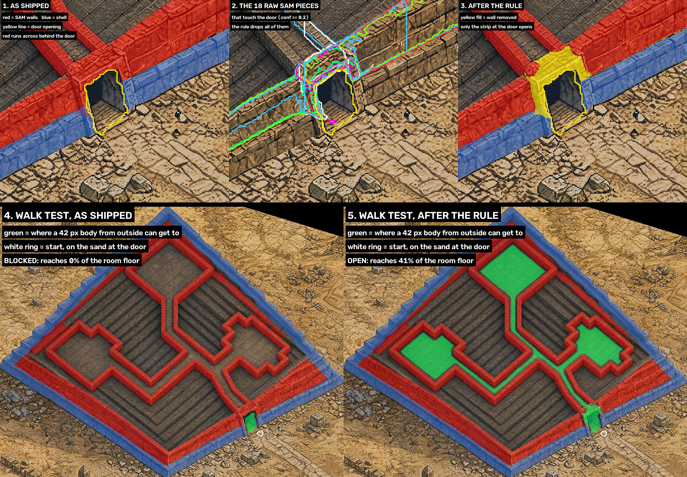

# Interiors workflow

Notes on running the interiors pipeline (`python -m tools.painted_map_pipeline.interiors.cli`)
that the code does not enforce yet. Read before running `new` on a level.

## Building names when you discover a level again

**The problem.** `new --identify sam3` names every building it finds after your answer to
"What is this object?" plus a rank by SAM's score: `pyramid_01`, `pyramid_02`, ...
(`discover.py`, `Candidate.name`). It never looks at the buildings already on the map. So a
building that is already there comes back under a new name, and accepting it writes a second
building on top of the first.

`write_plan` cannot catch this: it only replaces objects carrying the new building's own
name (`<name>`, `<name>_door`, `<name>_wall_NN`, `<name>_shell_NN`, `<name>_chamber`,
`<name>_sight_NN`). An object with a different name in the same place is left alone.

**What happened (2026-10-18).** On `levels/Frostreach/sunspine_7x6_play`, discovery named the
great pyramid `pyramid_01`. The map already had it as `great_pyramid` (a default name from
the first version of the tools, not something typed in a run). After accept, both sat in
the same place:

| object          | footprint x | footprint y | door x    | door y    |
|-----------------|-------------|-------------|-----------|-----------|
| `great_pyramid` | 5850-9450   | 2690-5830   | 8350-8720 | 4790-5230 |
| `pyramid_01`    | 5828-9559   | 2672-5617   | 8463-8641 | 4896-5167 |

In the game the old `great_pyramid` and its September interior are what you see;
`pyramid_01` looks missing.

**Before running `new` on a level that already has buildings:**

1. List what is on the map:
   `python -m tools.painted_map_pipeline.interiors.cli list --map levels\...\map.tmx`
2. At the discovery review, compare each candidate with that list. If one is a building the
   map already has, decide before accepting:
   - **Replace the old one:** delete the old building's objects from the map in Tiled -- the
     building, `<old>_door`, and any `<old>_wall_*`, `<old>_shell_*`, `<old>_chamber`,
     `<old>_sight_*` -- then accept the new one.
   - **Keep the old one:** do not accept the candidate (`u` to put it back in question).
3. After accept, check the map has one building in that place, not two.

## Next step

- Make accept check it: before writing, find any existing building whose footprint mostly
  overlaps the new one, and ask -- replace it (take over its name), keep both, or stop.

## Entrance closed by SAM walls behind the door

**The problem.** The walls you collide with are SAM3's "stone border" pieces from the painting
(`sam_room.sam_walls`). The model paints the top of a thick wall straight over the passage
through it, so SAM finds stone right behind the door opening. Nothing catches it: the way in
is cut out of SAM's walls only as far as the plan's first floor pixel, and
`emit.assert_passage_open` checks a 1 px line up to that same pixel. Past it, SAM walls on the
plan's floor are allowed.

**What happened (2026-10-31).** On `great_pyramid` the opening itself was clear, but
`great_pyramid_wall_05` ran across behind it (panel 1). A body starting on the sand outside the
door reached none of the room floor (panel 4).

**Rule tried on the cached SAM output** (no new SAM run): drop every raw piece at confidence
>= 0.2 that touches the door polygon, in both SAM passes. That dropped 18 pieces (panel 2) and
removed only the strip at the door (panel 3). After that, a body reaches the corridor and all
three rooms (panel 5). Filtering by angle to the door or by size left it shut: the arch blocks
are chunky, so their angle reads 33-49 degrees. Dropping a long wall band is safe because
other SAM pieces overlapping it still cover the wall away from the door.

**In the pipeline.** `sam_room.sam_walls` drops the pieces touching the door
(`DOOR_TOUCH_PX`). `emit.assert_passage_open` runs the walk test (`emit.walk_in`) in place of
the 1 px line, so a shut entrance is refused rather than written. The accept screen's walls
overlay shows the walk in green, as in panels 4 and 5.
